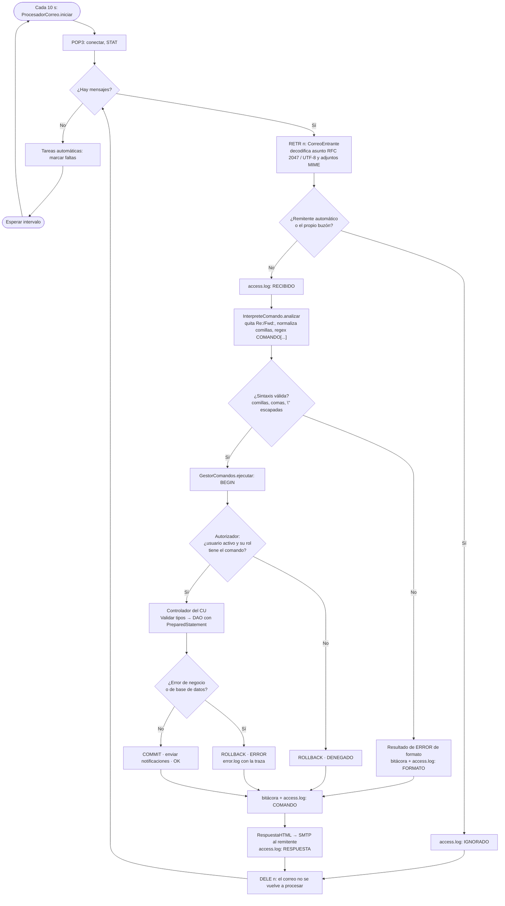
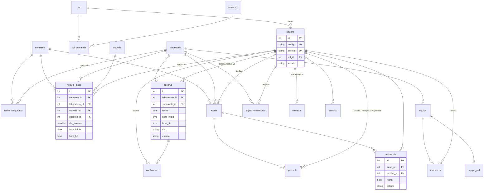

# Sistema de Gestión de Laboratorios vía Mail — Grupo 08 SA

Aplicación Java 17 que lee el buzón `grupo08sa@tecnoweb.org.bo` por **POP3**, interpreta el comando del asunto,
lo ejecuta sobre PostgreSQL y responde por **SMTP** con tablas HTML. POP3 y SMTP están implementados con sockets.

## Arquitectura en 3 capas

```
src/main/java/bo/uagrm/grupo08sa/
├── App.java, Config.java
├── presentacion/              Capa de presentación (el correo)
│   ├── correo/                ClientePOP3, ClienteSMTP, CorreoEntrante (MIME y adjuntos), CodificacionMIME
│   ├── ProcesadorCorreo       ciclo leer → interpretar → negocio → responder → eliminar
│   ├── InterpreteComando      asunto → Comando
│   ├── RespuestaHTML          Resultado → HTML del correo
│   ├── NotificadorCorreo      implementa el Notificador del negocio enviando correos
│   └── ConsolaLocal           pruebas sin correo
├── negocio/                   Capa de negocio
│   ├── GestorComandos         autoriza, despacha al controlador, registra en bitácora
│   ├── Autorizador            permisos por rol (rol_comando)
│   ├── Disponibilidad         cruza horario, reservas, fechas bloqueadas y estado del laboratorio
│   ├── Notificador (interfaz), Notificaciones, Busquedas, Validar, Formato, LectorHorario (.xlsx/.csv)
│   └── controladores/         UsuarioController (CU1), ConfiguracionController (CU2), HorarioController (CU3),
│                              ReservaController (CU4), PermutaController (CU5), InventarioController (CU6),
│                              AsistenciaController (CU7), ReporteController (CU8), AyudaController
└── datos/                     Capa de datos
    ├── Conexion, Fila, InicializadorBD
    ├── modelo/                Usuario, Rol
    └── dao/                   BaseDAO + un DAO por tabla (siempre PreparedStatement)
```

Dependencias: presentación → negocio → datos. El negocio avisa a los usuarios mediante la interfaz `Notificador`,
que implementa la presentación; así el negocio no depende de SMTP.

**Transacciones:** `GestorComandos` ejecuta cada comando en una sola transacción (`Conexion.iniciarTransaccion` →
`confirmar` / `revertir`). Si algo falla, nada queda a medias. Los correos de aviso se envían solo después del
COMMIT y la bitácora se escribe fuera de la transacción, así también quedan registrados los errores.

## Flujo del analizador de correos



## Logs

En la carpeta `logs/` (configurable con `log.directorio`):

| Archivo | Contenido |
|---|---|
| `access.log` | Una línea por evento: `INICIO`, `RECIBIDO` (remitente, asunto, adjunto), `COMANDO` (comando, resultado `OK`/`ERROR`/`DENEGADO`/`FORMATO`, detalle y duración), `RESPUESTA` (enviada o fallida), `NOTIFICACION`, `IGNORADO` |
| `error.log` | Cada excepción capturada (base de datos, POP3/SMTP, errores internos) con su traza completa |

Además, cada comando queda en la tabla `bitacora`.

## Base de datos

PostgreSQL `db_grupo08sa`, esquema **`sislab`** (`sql/01_esquema.sql`). 21 tablas:

| Área | Tablas |
|---|---|
| Seguridad (CU1, CU2) | `rol`, `comando`, `rol_comando` (qué comandos puede usar cada rol), `usuario` |
| Configuración (CU2) | `laboratorio`, `semestre` (solo uno `ACTIVO`), `fecha_bloqueada` |
| Horarios (CU3) | `materia`, `horario_clase` |
| Reservas (CU4) | `reserva`, `notificacion` |
| Permutas y chat (CU5) | `turno`, `permuta`, `mensaje` |
| Inventario (CU6) | `equipo`, `equipo_red`, `incidencia`, `objeto_encontrado` |
| Asistencia (CU7) | `asistencia`, `permiso` (y `turno`) |
| Auditoría | `bitacora` |



Reglas principales en la base: códigos y correos únicos, `CHECK` en todos los estados y en que `hora_fin > hora_inicio`,
un solo semestre activo (índice único parcial) y una asistencia por turno y fecha. El detalle de columnas de cada caso
de uso está en los archivos `CU*_DISENO_Y_DATOS_*.txt`.

## Primer uso

1. Copiar `config.example.properties` como `config.properties` y completar las contraseñas.
2. Compilar (no hace falta instalar Maven; necesita `JAVA_HOME` apuntando al JDK 17): `mvnw.cmd package`
3. Verificar conexiones: `java -jar target\SistemaLaboratorios.jar --probar`
4. Crear la base (solo la primera vez): `java -jar target\SistemaLaboratorios.jar --crear-bd`

Las tablas están en el esquema **`sislab`** porque `public` ya tiene tablas de otros ejemplos.

| Modo | Qué hace |
|---|---|
| `java -jar target\SistemaLaboratorios.jar` | Escucha el buzón cada 10 s y marca las faltas automáticamente |
| `... --una-vez` | Procesa el buzón una sola vez |
| `... --local` | Escribir asuntos en la consola sin correo (`:de correo`, `:adjunto ruta`, `:tareas`, `:salir`) |
| `... --probar` | Prueba PostgreSQL, POP3 y si el SMTP permite responder a Gmail |
| `... --crear-bd` | Crea las tablas y los datos iniciales |
| `... --reiniciar-bd` | Borra todos los datos (pide escribir SI) y vuelve a crear la base |

En la consola de Windows, para ver bien las tildes: `chcp 65001` y `java -Dfile.encoding=UTF-8 -jar ...`

**Servidor de salida:** tecnoweb solo reenvía a Gmail/Hotmail desde IPs autorizadas. Para probar desde casa,
`config.properties` permite responder por `smtp.gmail.com` (puerto 465, SSL, contraseña de aplicación).

## Comandos

Formato del asunto: `COMANDO["param1","param2",...]`; sin parámetros: `COMANDO["*"]`.
Se toleran espacios extra, minúsculas en el comando, prefijos `Re:`/`Fwd:` y comillas tipográficas (“ ”).
Para poner una comilla dentro de un parámetro se escapa con `\"` y una barra invertida con `\\`:
`INSOBJ["LAB-41","Mochila \"Nike\" negra"]`.
Fechas `AAAA-MM-DD`, horas `HH:MM`, días `LUNES`…`SABADO` o `1`…`6`. Donde se pide un usuario se acepta su código o su correo.
Roles: `ENC` Encargado, `DOC` Docente, `AUX` Auxiliar, `DIR` Director de Carrera. `AYUDA["*"]` lista los comandos de su rol.

### CU1. Usuarios (ENC)
| Comando | Sintaxis |
|---|---|
| INSUSU | `INSUSU["codigo","nombre","apellido","correo","telefono","rol"]` o `INSUSU["...","rol","aula","gestion"]` |
| MODUSU | `MODUSU["codigo","nombre","apellido","correo","telefono","rol"]` o `MODUSU["...","rol","aula","gestion"]` |
| BAJUSU / ACTUSU | `BAJUSU["codigo"]` / `ACTUSU["codigo"]` |
| LISUSU | `LISUSU["*"]`, `LISUSU["AUX"]` (muestra Aula y Gestión), `LISUSU["DOC"]`, `LISUSU["INACTIVO"]` |

### CU2. Perfiles y configuración semestral (ENC; LISLAB todos)
| Comando | Sintaxis |
|---|---|
| ASICOM | `ASICOM["DOC"]` (ver), `ASICOM["DOC","AGREGAR","LISEQU,LISOBJ"]`, `ASICOM["DOC","QUITAR","LISEQU"]` |
| INSLAB | `INSLAB["LAB-41","Laboratorio 41","40","Módulo 236, piso 4"]` |
| MODLAB | `MODLAB["LAB-41","Laboratorio 41","40","Módulo 236","MANTENIMIENTO"]` (DISPONIBLE, MANTENIMIENTO, INHABILITADO) |
| LISLAB | `LISLAB["*"]`, `LISLAB["DISPONIBLE"]` |
| INSSEM | `INSSEM["2-2026","2026-08-03","2026-12-12"]` |
| ACTSEM / CERSEM | `ACTSEM["2-2026"]` / `CERSEM["2-2026"]` |
| INSFEB | `INSFEB["2026-11-02","FERIADO","Todos Santos"]`, `INSFEB["2026-11-20","MANTENIMIENTO","Cableado","LAB-41"]` (FERIADO, PSA, MANTENIMIENTO, OTRO) |
| LISFEB | `LISFEB["*"]` (semestre activo), `LISFEB["2-2026"]` |

### CU3. Carga horaria y disponibilidad (ENC carga; todos consultan)
| Comando | Sintaxis |
|---|---|
| INSHOR | `INSHOR["LAB-41","MARTES","07:00","09:15","INF513","Tecnología Web","SA","219020"]` |
| CARHOR | `CARHOR["*"]` con un **.xlsx o .csv adjunto**, columnas `LAB, DIA, INICIO, FIN, SIGLA, MATERIA, GRUPO, DOCENTE` (ver `pruebas/horario_ejemplo.xlsx`) |
| MODHOR | `MODHOR["id","LAB-41","MARTES","07:00","09:15","INF513","Tecnología Web","SA","219020"]` |
| ELIHOR | `ELIHOR["id"]` |
| LISHOR | `LISHOR["*"]`, `LISHOR["LAB-41"]`, `LISHOR["LUNES"]`, `LISHOR["LAB-41","LUNES"]` |
| CONDIS | `CONDIS["2026-11-03","08:00","10:00"]` (laboratorios libres), `CONDIS["LAB-41","2026-11-03"]` (agenda del día) |

La materia se crea automáticamente la primera vez que aparece su sigla.

### CU4. Reservas (DOC, AUX, DIR solicitan; ENC aprueba)
| Comando | Sintaxis |
|---|---|
| INSRES | `INSRES["LAB-41","2026-11-03","08:00","10:00","EXAMEN","Primer parcial"]` (EXAMEN, RECUPERACION, PRACTICA, EVENTO) |
| APRRES / RECRES | `APRRES["id"]` / `RECRES["id","motivo"]` |
| CANRES | `CANRES["id"]` (el solicitante o el Encargado) |
| LISRES | `LISRES["*"]`, `LISRES["PENDIENTE"]` (el Encargado ve todas; los demás, las suyas) |

Si hay conflicto se rechaza y se proponen laboratorios libres en la misma franja. Al aprobar se notifica al
solicitante y al auxiliar de turno.

### CU5. Permutas y chat interno
| Comando | Sintaxis |
|---|---|
| SOLPMT | `SOLPMT["id_turno","2026-11-05","reemplazante"]` (AUX) |
| ACEPMT / RECPMT | `ACEPMT["id"]` / `RECPMT["id"]` (el reemplazante; el Encargado también puede rechazar) |
| APRPMT | `APRPMT["id"]` (ENC, después de que el reemplazante acepte) |
| LISPMT | `LISPMT["*"]`, `LISPMT["ACEPTADA"]` |
| ENVMSJ | `ENVMSJ["destinatario","mensaje"]` |
| LISMSJ | `LISMSJ["*"]`, `LISMSJ["NOLEIDOS"]` |

### CU6. Inventario, incidencias y objetos encontrados
| Comando | Sintaxis |
|---|---|
| INSEQU | `INSEQU["PC-L41-01","LAB-41","COMPUTADORA","Core i5, 16 GB"]` (COMPUTADORA, PROYECTOR, COMPONENTE, SOFTWARE, OTRO) |
| MODEQU | `MODEQU["PC-L41-01","LAB-41","COMPUTADORA","descripción","OPERATIVO"]` |
| BAJEQU | `BAJEQU["PC-L41-01"]` |
| LISEQU | `LISEQU["*"]`, `LISEQU["LAB-41"]`, `LISEQU["EN_REPARACION"]` |
| LISRED | `LISRED["*"]`, `LISRED["LAB-41"]` (ENC, AUX: IPs, gateways, DNS, proxies de equipos) |
| INSINC | `INSINC["PC-L41-01","No enciende el monitor"]` (DOC, AUX) |
| MODINC | `MODINC["id","EN_ATENCION"]`, `MODINC["id","RESUELTA","solución"]` |
| LISINC | `LISINC["*"]`, `LISINC["PENDIENTE"]`, `LISINC["LAB-41"]` |
| INSOBJ | `INSOBJ["LAB-41","Mochila negra"]`, `INSOBJ["LAB-41","Celular","2026-10-28"]` |
| ENTOBJ | `ENTOBJ["id","nombre de quien recibe","CI"]` |
| LISOBJ | `LISOBJ["*"]`, `LISOBJ["EN_CUSTODIA"]` |

### CU7. Asistencia de auxiliares
| Comando | Sintaxis |
|---|---|
| INSTUR | `INSTUR["auxiliar","LUNES","08:00","12:00"]` o con laboratorio al final |
| LISTUR | `LISTUR["*"]` (el auxiliar ve los suyos), `LISTUR["auxiliar"]` |
| MARENT / MARSAL | `MARENT["*"]` / `MARSAL["*"]` |
| INSPMS | `INSPMS["auxiliar","2026-11-05","motivo"]` |
| LISASI | `LISASI["auxiliar","2026-10-01","2026-10-31"]`, `LISASI["*","desde","hasta"]`, `LISASI["auxiliar"]` |

Entrada aceptada desde 15 min antes; hasta 10 min tarde es PUNTUAL y hasta 30 min, ATRASO. Pasados 30 min sin
entrada, el sistema registra FALTA automáticamente (o PERMISO si lo tiene) y avisa al Encargado.
Las permutas aprobadas se toman en cuenta.

### CU8. Reportes (ENC, DIR)
| Comando | Sintaxis |
|---|---|
| REPOCU | `REPOCU["2026-08-03","2026-12-12"]` ocupación por laboratorio (lunes a sábado, 15 h/día) |
| REPRES | `REPRES["desde","hasta"]` reservas por estado, tipo y laboratorio |
| REPINC | `REPINC["desde","hasta"]` incidencias y objetos encontrados |
| REPASI | `REPASI["desde","hasta"]` asistencia por auxiliar |
| ESTSEM | `ESTSEM["*"]` (semestre activo), `ESTSEM["2-2026"]` |
